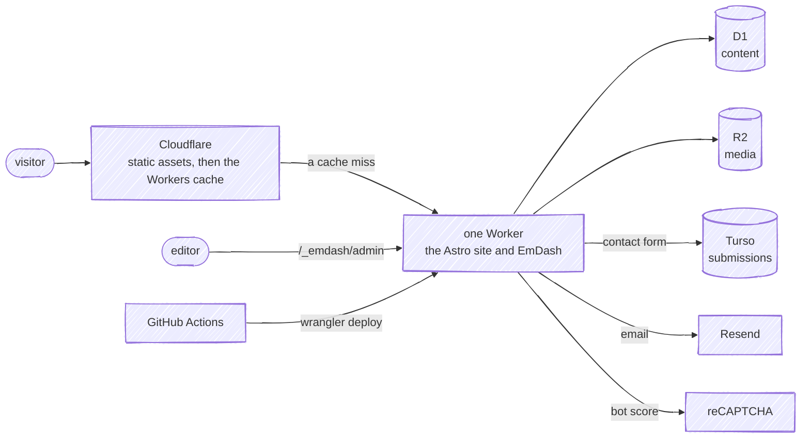

# biancafiore

[](https://github.com/fbuireu/biancafiore/actions/workflows/ci.yml)
[](https://codecov.io/gh/fbuireu/biancafiore)

The portfolio and blog of Bianca Fiore, a content writer, live at **[biancafiore.me](https://biancafiore.me)**: a Blog of long-form Articles browsed by Tag and by Author, a portfolio of Projects with the Testimonials and the Cities behind the biography, and a contact form.

## Stack

- **Astro**, rendering every content page on request on **Cloudflare Workers**, behind the Workers cache, with **React** islands only where a page needs interaction (the contact form and the globe).
- **EmDash**, the CMS, running inside the same Worker: its admin at `/_emdash/admin`, the content in **D1**, the media in **R2**. A publish purges the cached pages; nothing rebuilds.
- **Turso**, through Drizzle, for the contact submissions, and **Resend** for the email the contact form and the CMS send, with **reCAPTCHA** in front of the form.
- **Effect** for the CMS, database and email clients, a domain layer behind an anti-corruption layer over the CMS, and **GitHub Actions** deploying with wrangler.



## Quick start

Node and pnpm are pinned once, in `.nvmrc` and `engines.node`, and in `packageManager`. Always pnpm.

```bash
pnpm install            # also installs the git hooks
cp .env.example .env    # fill in the values; local secrets go in .dev.vars
pnpm dev                # astro dev, with EmDash on a local D1 and R2
pnpm wrangler:dev       # build, then run in the real Workers runtime
```

`pnpm dev` prints a link that signs you in to the local admin at `/_emdash/admin` without a passkey. The local database starts empty, and the content pages answer 500 until it holds an Article credited to a byline.

## Checks

```bash
pnpm verify             # format check, typecheck, astro check, unit tests with coverage
```

`pnpm verify` runs what CI's `Verify` job runs, as parallel steps there, the docs contract included: a test that holds the documentation to the code. `pnpm test:e2e` runs the Playwright suite in Chromium and WebKit.

## Deploy model

- **Every pull request** gets a preview Worker of its own on `workers.dev`, its URL commented on the pull request, and the end-to-end suite runs against it. A preview hides the unpublished routes (`HIDE_CHROME`), and a pull request from a fork gets no secrets, so no preview.
- **Every merge to `main`** deploys production, runs the smoke cases against it and rolls it back when one fails; semantic-release then tags the version.
- **Every publish in the CMS** goes live on the next request, because EmDash purges the cached pages it touched.

## Documentation

- [The wiki](https://github.com/fbuireu/biancafiore/wiki): the architecture, how a request, a publish and a contact submission flow, and CI/CD, with diagrams.
- [CONTRIBUTING.md](.github/CONTRIBUTING.md): the checks, the commit rules and the pull request flow.
- [SECURITY.md](.github/SECURITY.md): what is in scope, and how to report a vulnerability privately.
- [AGENTS.md](AGENTS.md) and the guide in each folder: what someone editing the tree needs to know.
- [CODING_STANDARDS.md](CODING_STANDARDS.md) and [GLOSSARY.md](GLOSSARY.md): how code is written here, and what its words mean.
- [docs/adr/](docs/adr/): why each decision was made.

## License

- **Source code** (components, styles, config) is licensed under [MIT](LICENSE).
- **The content** (the Articles, the Projects, the Testimonials and the original images) is **© Bianca Fiore. All rights reserved**. It is not in this repository: it lives in EmDash, in the site's own database and media bucket, and no part of it may be reproduced, distributed or used in any form without prior written permission. For permissions, get in touch via [biancafiore.me](https://biancafiore.me).

A mistake in the content is fixed in the CMS, not by a pull request: report it with the [content issue template](https://github.com/fbuireu/biancafiore/issues/new?template=content_issue.yml).
