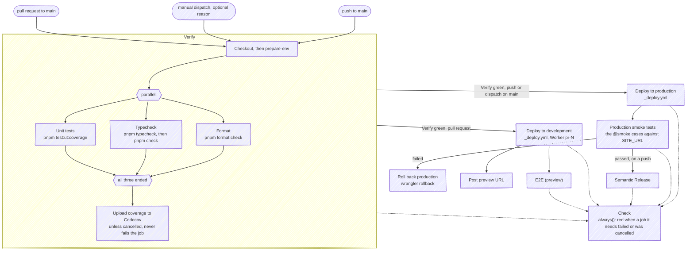
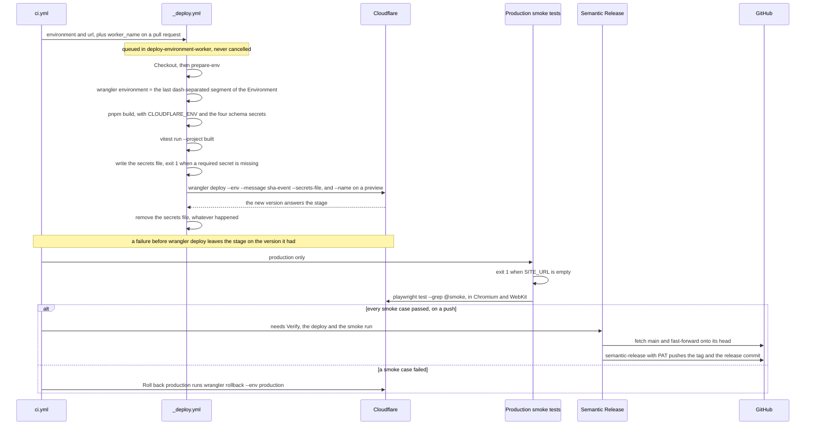
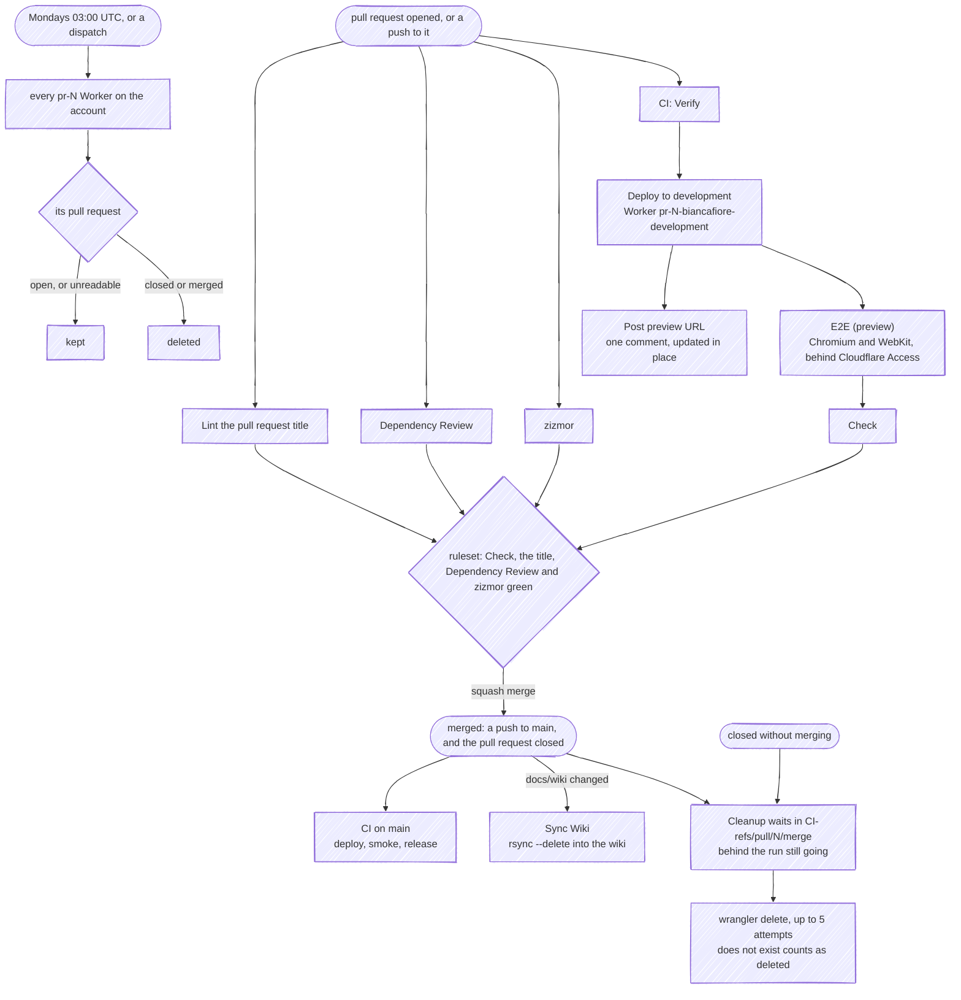

# CI/CD

Everything runs through GitHub Actions, and the site deploys to Cloudflare Workers with wrangler. The custom domain sits on the production environment; per-PR previews get their own Worker, deleted when the pull request closes.

---

## The workflows

| Workflow | Runs on | Does |
|---|---|---|
| `ci.yml` | push to `main`, pull requests to `main`, manual dispatch | A `Verify` job running the checks of `pnpm verify` as parallel steps, then both deploys, the preview comment, the end-to-end run against the preview, the production smoke run, the rollback and the release, and a `Check` job that aggregates them: the one context of this workflow the branch ruleset requires. A dispatch takes an optional `reason`, which becomes the run's name (*Redeploy production: …*) |
| `_deploy.yml` | `workflow_call` | The shared deploy both environments call: the build, the built-output gate, the Worker secrets and `wrangler deploy` |
| `cleanup-development.yml` | pull request closed; Mondays at 03:00 UTC; manual dispatch | Deletes the per-PR preview Worker once its CI run has finished, and on the schedule or on demand sweeps the preview Workers of closed pull requests |
| `sync-wiki.yml` | push to `main` touching `docs/wiki/**` or the workflow itself | Publishes this wiki |
| `zizmor.yml` | push to `main`, pull requests | Security linting of the workflows themselves, uploaded to code scanning |
| `dependency-review.yml` | pull requests | Fails a pull request introducing a known-vulnerable dependency |
| `commit-message.yml` | pull request opened / edited / reopened / synchronize | commitlint on the **pull request title** |
| `dependabot-auto-merge.yml` | Dependabot pull requests, opened or synchronized | Approves and auto-merges a patch or minor update, or one to an indirect or development dependency; comments on and labels a major one for review. Renovate merges its own once `Check` is green |

Every job that needs the toolchain starts with the composite action `prepare-env`, [below](#prepare-env). Two things run outside these files: CodeQL's default setup, which analyses the workflows and the TypeScript on every push to `main`, every pull request and once a week, and the rulesets on `main` and on the tags, [further down](#rulesets-and-required-checks).

---

## The pipeline

What `ci.yml` runs, and on which event. The three checks inside `Verify` are steps of one job that run in parallel, so the job takes as long as the slowest of them and each reports in its own log:

- **Typecheck and `astro check` share one step, one after the other**, because both regenerate the types Astro generates (`astro sync`), and two steps doing that at once would race over the same files. Format and the unit tests touch neither, so they run beside it. `pnpm verify` still chains the same checks locally, one after another, and the docs test runs inside the unit tests.
- **The Codecov upload cannot turn `Verify` red.** It runs whenever the job was not cancelled, failed checks included, so a red run still reports its coverage, and `fail_ci_if_error` is off: Codecov being down is not a reason to block a merge. The coverage floor that does gate is the one in `vitest.config.ts`, which fails the unit-test step.
- **A pull request's run is cancelled by its next push; a run on `main` never is.** The concurrency group is the workflow and the ref, and only a pull request cancels the run in progress.
- **On a push or a dispatch on `main`**, production deploys, the smoke run tests it, and a failed smoke run rolls it back. The release runs on a push only and needs `Verify`, the deploy and the smoke run, so a dispatch redeploys production, for a rotated credential, and cuts no release.
- **On a pull request**, the preview deploys to its own Worker, the URL goes into one comment on the pull request, updated in place on every push, and the end-to-end suite runs against it.
- **`Check` runs under `always()`** and needs `Verify`, both deploys, `E2E (preview)`, `Production smoke tests` and `Semantic Release`: it fails when any of them failed or was cancelled, and a job skipped because the event does not run it counts as passing. The comment and the rollback are not in its `needs`.

---

## A deploy, step by step

`_deploy.yml` is the only path to a stage. Production calls it with the `production` Environment and the site's URL; a pull request calls it with `development`, a Worker name of its own (`pr-<number>-biancafiore-development`) and that Worker's `workers.dev` URL. The production half of what follows it is the smoke run, the rollback and the release:

- **The Environment names the stage once.** The workflow takes the GitHub Environment alone and derives wrangler's from its last dash-separated segment, which also becomes `CLOUDFLARE_ENV` for the build, so a caller cannot pair `production` with the development `[env.*]` block.
- **The built output is tested before anything leaves the runner.** `vitest run --project built` runs `docs/built-output.test.ts` over what the build just emitted: the prerendered legal pages, every inline script they carry named in the policy, no inline handler, the `_headers` rule short enough for Cloudflare to read, and `/_image` answered by EmDash's endpoint, under the image rule, with the `IMAGES` binding in the deployed config. A red result stops the job before the secrets file is written, so a policy that would block the site's own scripts never ships.
- **The build needs every server secret.** The env schema's four secrets, `GOOGLE_RECAPTCHA_SECRET_KEY`, `RESEND_API_KEY`, `ASTRO_DB_REMOTE_URL` and `ASTRO_DB_APP_TOKEN`, go to the Build step, because the module Astro generates for them throws on the first one missing when the build loads it. The collect step gets the same four plus the optional `EMDASH_ENCRYPTION_KEY` and the Google OAuth pair, writes the ones it has into a JSON file under `$RUNNER_TEMP`, and refuses to go on when a required one is empty. No other step sees any of them.
- **The runtime secrets travel with the deploy in that file**, so a deploy is one version rather than a deploy followed by a secret write that leaves the new code running against the old values in between. The upload is additive: a secret the file omits is not deleted, and the file is removed in a step that runs whatever happened before it.
- **The build reads the public variables** (`SITE_URL`, `BIANCA_EMAIL`, `TWITTER_HANDLE`, `GOOGLE_ANALYTICS_ID`, `GOOGLE_TAG_MANAGER_ID`, `GOOGLE_RECAPTCHA_SITE_KEY`, `BETTER_STACK_TRACKING_TOKEN` and `HIDE_CHROME`) from the job's environment, because Astro inlines them into the bundle; a required one left empty fails the build on the env schema.
- **Two deploys of one Worker never overlap.** The concurrency group is the Environment and the Worker name, queued rather than cancelled, so a second push to `main` waits for the first deploy to finish instead of interrupting it half-way.
- **A failed deploy changes nothing live.** Whether the build, the built-output test, a missing secret or a log destination that does not exist stopped it, the stage keeps the version it had; on `main` the smoke run, the rollback and the release are skipped and `Check` turns red.
- **Neither the build nor the deploy is wrapped in a retry.** Both fail deterministically far more often than on a network flake, a retry wrapper cannot tell the two apart, and wrangler already retries its own API calls.
- **The `--message` is `<sha>-<event>`**, so a deployment reads as the commit it shipped. It is one token with no spaces because the three repositories that deploy share the format, and in forever-pto the OpenNext wrapper re-spawns wrangler through a shell that splits a message on its spaces; the docs test holds every deploy to it.
- **A deploy ships the CMS too.** EmDash runs inside this Worker and applies its own migrations on the first request after a deploy, against the stage's D1 database. [Limits](#limits) says what a rollback cannot undo.

---

## A pull request, from open to cleanup

The preview a pull request deploys is an ephemeral environment of its own, [below](#per-pr-previews-ephemeral-environments): what creates it, what it serves, who can reach it and what is left once it is deleted.

**Every Playwright run uses two browsers.** The end-to-end run against the preview and the smoke run against production both run each case in Chromium and in WebKit, the engine behind Safari, and each job installs both behind a cache keyed on the pair, so a cache saved with one browser is never restored into a run of both. The docs test holds the projects and the install.

**The wiki is a copy.** `sync-wiki.yml` clones the repository's wiki with `PAT`, mirrors `docs/wiki` into it with `rsync --delete`, and commits only when something changed, under the author of the commit that triggered it. A page edited in the GitHub UI is overwritten by the next sync.

---

## Per-PR previews (ephemeral environments)

Every pull request to `main` gets a Worker of its own on `workers.dev`, built from the pull request merged into `main`, as GitHub tests it, and deleted when the pull request closes. It lives as long as the pull request does, so nothing about it needs tidying by hand.

- **Created by the pull request's own CI run.** `Deploy to development` runs on every `pull_request` event `ci.yml` takes, opened, a push to the branch and a reopen, once `Verify` is green, and calls `_deploy.yml` with the `development` Environment and the Worker name `pr-<number>-biancafiore-development`. The first deploy creates the Worker and every later push replaces its version. It deploys the `[env.development]` block of `wrangler.toml` under that name, so it binds the same `SESSION` KV, `DB` and `MEDIA` as every other preview, with `HIDE_CHROME` true and no cron trigger. A pull request into any other branch gets no preview, and neither does one from a fork, whose build has no secrets ([Limits](#limits)).
- **Its address goes into one comment.** The preview answers at `https://pr-<number>-biancafiore-development.fbuireu.workers.dev`, which is also the URL of the `development` Environment's deployment on the pull request. `Post preview URL` finds the comment `github-actions[bot]` left with the `<!-- preview-deployment -->` marker and replaces its body with the URL, the branch and the head commit, so the pull request carries one comment however many times it is pushed, and a new one only the first time.
- **Cloudflare Access stands in front of it.** The preview sits behind Cloudflare Access, which is configured in the account's dashboard and not in this repository, so nothing here creates, checks or changes it. A person opening the link meets the Access login. `E2E (preview)` gets through with the service token the `development` Environment holds, `CF_ACCESS_CLIENT_ID` and `CF_ACCESS_CLIENT_SECRET`, which [`e2e/fixtures.ts`](https://github.com/fbuireu/biancafiore/blob/main/e2e/fixtures.ts), where every spec takes its `test` from, adds as `CF-Access-Client-Id` and `CF-Access-Client-Secret` to the requests whose origin is the preview's, and to the requests a spec makes itself. What a page asks of a third party, Tag Manager, Calendly or any other, carries no token, which `extraHTTPHeaders` in the config could not promise: Playwright sends those on every request. The docs test holds the imports and the config.
- **The end-to-end suite runs against it, and gates the merge.** `E2E (preview)` needs the deploy, sets `BASE_URL` to the preview's address and runs `pnpm test:e2e` in Chromium and WebKit, uploading the Playwright report for seven days. `Check` needs it, so a red run blocks the merge. The preview is not a faithful target: `HIDE_CHROME` is true there, so the suite sees an under-construction placeholder on the unpublished routes (see [Rendering and Routing](Rendering-and-Routing)), and the contact specs skip themselves.
- **It shares its data with every other preview.** Every preview reads and writes the development database, media bucket and `SESSION` namespace, which hold content of their own: EmDash's guidance is never to bind a preview to production's, and the first deploy of each stage is done by hand, in an order [`AGENTS.md`](https://github.com/fbuireu/biancafiore/blob/main/AGENTS.md)'s Deploy section spells out. An EmDash release a pull request brings migrates that shared database on the preview's first request, under every other preview too.
- **Deleted when the pull request closes, merged or not.** `Delete the preview Worker` in `cleanup-development.yml` runs on the `closed` event with the `development` Environment's Cloudflare credentials. Closing a pull request does not cancel the CI run already going, so the cleanup queues behind that run, in a concurrency group spelled from the pull request number, `CI-refs/pull/<number>/merge`, the group `ci.yml` computes for the pull request's own run; the coupling is by `ci.yml`'s `name:`, `CI`, and it is what lets the end-to-end run finish against a Worker that still exists. It then runs `wrangler delete` on the Worker, retried up to five times, ten seconds apart, and wrangler answering that the Worker does not exist counts as done, so a preview that never deployed closes cleanly. A reopened pull request deploys a new one on its next run.
- **A weekly sweep catches what a cleanup missed.** `Sweep orphaned preview Workers`, in the same workflow, runs on Mondays at 03:00 UTC and on a manual dispatch. It lists every Worker on the account through Cloudflare's API, takes the ones named `pr-<number>-biancafiore-development`, and asks GitHub for each pull request's state: an open one is kept, one it cannot read is kept rather than guessed at, and a closed or merged one is deleted. A delete that fails stops the sweep and turns its run red, and the next run tries again.
- **What survives a preview.** Only the Worker goes. What it wrote stays where it wrote it: entries, media and admin logins in the shared development database, bucket and namespace, and any migration it applied to that database. So do the stable `biancafiore-development` Worker, which no sweep matches and which `EMDASH_SITE_URL` names for development because a preview's own address changes with every pull request, the pull request's comment, now pointing at nothing, the Environment's deployment record, the Playwright report until its seven days are up, and whatever the preview logged, already exported to the development pair of log and trace destinations.

---

## Secrets and variables

Every name a workflow or the composite action reads, besides the `GITHUB_TOKEN` each run gets. **Scope** is where a job can read it from: a job that declares a GitHub Environment (`production` or `development`) reads that Environment's value, and the repository's when the Environment has none, so a name read there can differ per stage; a job that declares none reads the repository's alone.

| Name | Kind | Scope | Consumer | When it is missing |
|---|---|---|---|---|
| `CLOUDFLARE_API_TOKEN` | secret | Environment | `_deploy.yml`, `Roll back production`, both jobs of `cleanup-development.yml` | wrangler cannot authenticate: the deploy, the rollback, the preview cleanup and the sweep fail |
| `CLOUDFLARE_ACCOUNT_ID` | secret | Environment | the same | the same |
| `GOOGLE_RECAPTCHA_SECRET_KEY` | secret | Environment | `_deploy.yml`: the build and the Worker | the build fails on the env schema, so nothing deploys; a Worker whose value is rotated answers every submission with the generic error |
| `RESEND_API_KEY` | secret | Environment | `_deploy.yml`: the build and the Worker | the build fails; the contact form and the CMS email both send through it |
| `ASTRO_DB_REMOTE_URL` | secret | Environment | `_deploy.yml`: the build and the Worker | the build fails; the contact form's Turso connection is this |
| `ASTRO_DB_APP_TOKEN` | secret | Environment | `_deploy.yml`: the build and the Worker | the build fails |
| `EMDASH_ENCRYPTION_KEY` | secret, optional | Environment | `_deploy.yml`: the Worker | left out of the secrets file, so the Worker keeps the value it had; no plugin here stores a secret setting, so nothing breaks today |
| `EMDASH_OAUTH_GOOGLE_CLIENT_ID` | secret, optional | Environment | `_deploy.yml`: the Worker | the admin's *Sign in with Google* answers that the provider is not configured; passkeys keep working |
| `EMDASH_OAUTH_GOOGLE_CLIENT_SECRET` | secret, optional | Environment | `_deploy.yml`: the Worker | the same |
| `CF_ACCESS_CLIENT_ID` | secret | Environment, `development` | `E2E (preview)` | with neither, every request meets the Access login and the run fails; with one alone the fixture throws |
| `CF_ACCESS_CLIENT_SECRET` | secret | Environment, `development` | `E2E (preview)` | the same |
| `PAT` | secret | repository, and Dependabot | `Semantic Release`, `sync-wiki.yml`, `dependabot-auto-merge.yml` | the release cannot push its commit and tag, the wiki sync cannot clone and push the wiki, which needs the token's write access to it, and a Dependabot update is neither approved nor merged |
| `CODECOV_TOKEN` | secret | repository | `Verify`, the Codecov upload | the upload can be refused, which does not fail `Verify`; the commit has no coverage report |
| `SITE_URL` | variable | repository, and Environment | `_deploy.yml`'s build, `Production smoke tests`, the production deploy's URL | the build fails on the env schema; when only the repository's is empty, production deploys, the smoke job's first step exits 1 and production rolls back |
| `BIANCA_EMAIL` | variable | Environment | `_deploy.yml`: the build | the build fails on the env schema |
| `TWITTER_HANDLE` | variable | Environment | `_deploy.yml`: the build | the build fails on the env schema |
| `GOOGLE_ANALYTICS_ID` | variable | Environment | `_deploy.yml`: the build, and the policy's digest of the consent script | the build fails on the env schema |
| `GOOGLE_TAG_MANAGER_ID` | variable | Environment | `_deploy.yml`: the build | the build fails on the env schema |
| `GOOGLE_RECAPTCHA_SITE_KEY` | variable | Environment | `_deploy.yml`: the build | the build fails on the env schema |
| `BETTER_STACK_TRACKING_TOKEN` | variable, optional | repository | `_deploy.yml`: the build | no Better Stack tag loads, whatever a visitor consents to |
| `HIDE_CHROME` | variable, optional | Environment, `true` in `development` | `_deploy.yml`: the build | read as `false`: the stage serves the whole site |

`BETTER_STACK_TRACKING_TOKEN` is a repository variable on purpose, one browser source for both stages told apart by the `environment` the tag is started with; it is public by construction and is not the credential the log export uses. `EMDASH_SITE_URL` is not a GitHub setting at all: it is a `[vars]` entry per stage in `wrangler.toml`, the origin the admin's passkeys are bound to.

---

## `prepare-env`

`.github/actions/prepare-env` is the composite action every job that runs the toolchain calls right after its checkout: `Verify`, both deploys through `_deploy.yml`, the smoke run, the rollback, the release, the end-to-end run, the title lint and both cleanup jobs. It takes no input, and it does four things:

1. fails the job when `.nvmrc` is missing, since that file is the one Node pin every job installs from;
2. installs pnpm through `pnpm/action-setup`, which reads `packageManager` in `package.json`;
3. installs Node from `.nvmrc` through `actions/setup-node`, with the pnpm store cached and keyed on the lockfile;
4. runs `pnpm install --frozen-lockfile`, so a lockfile out of step with `package.json` fails the job instead of being rewritten, and the install sets the git hooks up, which is how the release commit meets the `commit-msg` hook.

No workflow pins Node or pnpm a second time, and the docs test holds that: a version moves in `.nvmrc` and `engines.node`, or in `packageManager`, and every job follows. The jobs that only call an API or post a comment (`Post preview URL`, `Check`, `Dependency Review`, `zizmor`, `sync-wiki.yml` and `dependabot-auto-merge.yml`) skip it.

---

## Rulesets and required checks

**`main`** (the default branch) takes squash merges only, through a pull request, with a linear history, and cannot be deleted or force-pushed. It requires these contexts: `Check`, `Lint the pull request title`, `Dependency Review` and `zizmor`. A branch does not have to be up to date with `main` to merge. `Check` is an aggregate job that needs the verify, deploy, end-to-end, smoke and release jobs in `ci.yml` and fails when any of them failed or was cancelled, so the end-to-end run against the preview gates a merge without being named, which it could not be: every job in that workflow is conditional on the event, and a required check that never reports blocks the merge forever. Approvals are not required; the checks are the gate.

**The repository's admins bypass that ruleset**, and that is what lets the release job push the release commit straight to `main`: it pushes with `PAT`, the owner's token, so the push is the owner's and the pull-request rule does not stop it.

**Two rulesets guard the tags.** `release-tags` forbids deleting or moving any `v*` tag, with the admins able to bypass it; `tags` forbids deleting or force-pushing any tag at all, with the admins exempt and deploy keys allowed to bypass. A deployment-branch policy on the `production` environment accepts `main` only.

**CodeQL's default setup is not in a workflow file.** It is configured in the repository's code-scanning settings, analyses the workflows and the JavaScript and TypeScript on every push to `main`, every pull request and once a week, and its `Analyze` checks are not among the required ones. `zizmor` is, and its check comes from the SARIF its workflow uploads.

**Bots update dependencies two ways.** Renovate opens the version updates, on its schedule, from branches of this repository, and merges a pin, digest, patch or minor update, and the lock file maintenance, once `Check` is green; a major one waits for a person. There is no `dependabot.yml`, so Dependabot opens security updates alone, and `dependabot-auto-merge.yml` approves and auto-merges them by the rules in the table above.

---

## Limits

- **A pull request from a fork gets no secrets.** Its preview deploy fails at the build, which needs the server secrets, so the comment and the end-to-end run never run and `Check` turns red. A fork's change has to be pushed to a branch of this repository before its preview and its end-to-end run can pass.
- **A Dependabot pull request gets Dependabot's secrets alone.** A run Dependabot triggers sees neither the repository's secrets nor an Environment's, only those stored as Dependabot secrets, so `PAT` must also be stored as a Dependabot secret for `dependabot-auto-merge.yml` to approve and merge, and its CI run deploys a preview only when the deploy and Access secrets are stored there too.
- **Turso migrations are run by hand.** The contact submissions live in Turso, outside the Worker, and nothing in CI touches that database: a change to `src/infrastructure/db/schema.ts` comes with a migration in `drizzle/`, generated with `pnpm db:generate` and applied with `pnpm db:migrate` before the code that reads it deploys ([ADR 0003](https://github.com/fbuireu/biancafiore/blob/main/docs/adr/0003-drizzle-libsql-turso-over-astro-db.md)).
- **A rollback does not undo EmDash's migrations.** EmDash applies its core migrations to D1 on the first request after a deploy, and `wrangler rollback` restores the previous Worker version only, so the code it brings back meets the migrated database. That is why an EmDash update is tried on the preview first, whose run migrates the development database.
- **A failed rollback needs a person.** When `wrangler rollback` itself fails, production stays on the version the smoke run failed, the job is red, and the way back is a `wrangler rollback` by hand or a fix merged to `main`.
- **The release commit skips CI.** It carries `[skip ci]`, so its push starts no run; the next merge's run deploys it along with whatever that merge brings.

---

## Why the pull request title is the one that matters

`main` takes squash merges and the repository sets the squash title from the pull request title, so **that title is the commit semantic-release reads**. The local `commit-msg` hook validates the branch's own commits, which the squash then discards, and GitHub fills the pull request title from the *branch name* whenever a pull request carries more than one commit, so the default is rarely conventional.

The check re-runs on `synchronize` because a required check is evaluated against the head sha: without that trigger a new commit would leave it unreported and block the merge.

---

## The smoke run, and the rollback

**The smoke job is the only one that touches production.** The end-to-end run needs the preview deploy, which happens on pull requests only, so without the smoke job a push to `main` would deploy production and cut a tag without a single request to the live site. It declares no Environment, so it reads `SITE_URL` from the repository, and its first step fails when that is empty: Playwright would otherwise fall back to `localhost`, boot a dev server and pass against it.

A short set of cases carries a `@smoke` tag, and they are the cheapest things that prove the Worker is answering rather than merely deployed: the homepage with a non-empty title, an unknown path answering 404, `robots.txt`, and `/.well-known/security.txt`, served as plain text with a contact and an `Expires` still ahead. None of them names a feature, because a smoke case can only assert what the deploy it follows has already published. **The same set runs in every repository that deploys**, written the same way, so a set that differs between them is drift rather than a decision. The `security.txt` case also wants the body byte for byte the file in the repository: a `security.txt` the Cloudflare zone serves itself answers before the Worker, and the case is what notices one standing in for the repository's.

**`security.txt` lapses unless someone renews it.** Its `Expires` is two years after its last renewal, and the docs test fails 30 days before that date, so `main` turns red a month before the file lapses; renewing it means moving `Expires` forward, at most two years. [`SECURITY.md`](https://github.com/fbuireu/biancafiore/blob/main/.github/SECURITY.md) says the same, and the rule lives in the *Deploy* section of [`AGENTS.md`](https://github.com/fbuireu/biancafiore/blob/main/AGENTS.md).

The step passes no `--pass-with-no-tests`, and that is the point: Playwright exits non-zero on an empty set, so the flag would make a typo in the tag filter green.

**A failing smoke rolls production back.** A tag means the version is live *and answering*, so the release job needs both the production deploy and the smoke run. On its own that would leave a bad version serving traffic with only the tag withheld, so a separate rollback job returns the Worker to the previously live version when the deploy succeeded and the smoke failed. It is a separate job because it needs the Cloudflare credentials, and the smoke job deliberately declares no environment.

**A merge landing mid-release joins the release in flight.** The release job fast-forwards onto the head of `main` before semantic-release runs, so the version covers every commit on `main` at that moment and the run those commits queued has nothing left to publish; releasing from the run's own sha would make its version-bump push a non-fast-forward once another commit had landed. A tag can therefore precede the deploy of the commits it absorbed by a few minutes. Two cases still stand the job down, `main` rewritten under the run or a merge landing in the seconds between the fast-forward and the push, and both heal on their own: no tag was written, so the run the newer head queued cuts the release over everything since the last one. A manual dispatch on `main` redeploys production with the smoke run behind it, for a rotated credential, and cuts no release.

**What that costs is worth stating.** A case that fails for a reason outside the Worker now reverts a deploy that was fine. A case whose result depends on the caller's address does not belong in a set that can undo a release, which is why the feed and the sitemap are not in it: both answer `403` to a request from a datacenter address, from the edge rather than from the Worker, while a browser gets both.

---

## Where the logs go

Cloudflare keeps Workers Logs and Workers Traces for the site Worker and **exports both** to Better Stack through its own OTLP export: each stage names its own pair of destinations, configured in the account's dashboard with the endpoint and the token, so nothing in the repository holds a credential and rotating the sink needs no deploy. Neither signal is sampled: the rate is the one setting that loses data without a symptom, and this site serves too little traffic for sampling to save anything.

The application's own log lines reach the same place through `console`. That is deliberate rather than lazy: the export attributes console output to the active span and stamps its trace id, so a failed request's log line and the span it failed on answer one query, with nothing in the code producing the join. A sink posted to over HTTP from inside the Worker is invisible to the runtime and its lines would arrive with an empty trace id. Every line is one JSON object carrying the same `service`, `level` and `message` keys the sibling repositories use, so one query reads all three. Build-time logs stay human-readable in the build output and reach no sink at all.

**The destinations are dashboard settings, and a deploy naming one that does not exist fails.** The reasoning is recorded in [ADR 0020](https://github.com/fbuireu/biancafiore/blob/main/docs/adr/0020-logs-and-traces-leave-through-cloudflares-export.md).

---

## The release configuration

[`.releaserc.json`](https://github.com/fbuireu/biancafiore/blob/main/.releaserc.json) is one of six release configurations, this one, github-star-tracker's, contribKit's `web` and `app` and forever-pto's `apps/web` and `apps/docs`, and the six are the same file, laid out the same way, bar what a repository's shape demands: a package of a monorepo extends `semantic-release-monorepo` and sets its own `tagFormat`, github-star-tracker also commits `dist/`, and contribKit's app bumps `pubspec.yaml` through `@semantic-release/exec` where every other one bumps `package.json` through `@semantic-release/npm`. The `package.json` that runs semantic-release declares every plugin its configuration names, and `semantic-release` itself, so none resolves to the copy bundled inside `semantic-release` and Renovate moves every one of them. The docs test holds this repository's configuration to that shape, and [`CODING_STANDARDS.md`](https://github.com/fbuireu/biancafiore/blob/main/CODING_STANDARDS.md) lists the rule.

The release commit, `chore(biancafiore): release <version> [skip ci]`, is scoped to the package it releases, as in every one of those repositories, and here the scope is the package's `name`. No pull request check sees it, because the release job pushes it straight to `main`, but the `commit-msg` hook does: the release job's install sets the hooks up, and commitlint's `ignores` in `commitlint.config.ts` lets it through: its notes are semantic-release's, and a `BREAKING CHANGES` line longer than `body-max-line-length` would otherwise fail the commit after the tag exists. The `[skip ci]` is load-bearing: without it that push starts the run that cuts the next release.
