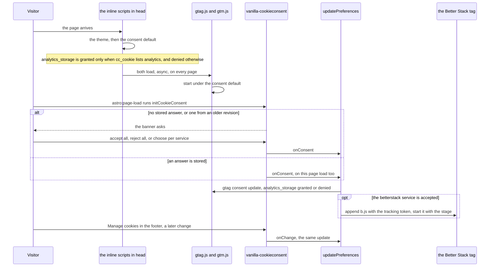

# Consent and Analytics

What the site measures, and how a visitor's answer to the cookie banner decides it. Everything here runs in the visitor's browser: the Worker only ships the scripts, and the content security policy that names each inline one by its digest. [ADR 0013](https://github.com/fbuireu/biancafiore/blob/main/docs/adr/0013-analytics-gated-behind-cookie-consent.md) records the decision; the rules an implementer has to keep are in the *Gotchas* of [`AGENTS.md`](https://github.com/fbuireu/biancafiore/blob/main/AGENTS.md).

Two vendors sit behind one *Performance and Analytics* category, gated two different ways: Google Analytics through Tag Manager, which has a consent mode and is told what it may store, and Better Stack's browser tag, which has none and is simply not loaded until the visitor allows it.

---

## A page load

1. **The consent default runs before Google does.** An inline script in `<head>`, built by `consentBootstrapScript`, reads the `cc_cookie` the banner writes and calls `gtag('consent', 'default', …)` with `analytics_storage` granted only when the stored answer lists the `analytics` category. It sits above the two Google scripts on purpose: Consent Mode applies the default it finds when Google's code starts, so a reorder, or this script dropped as dead weight, would collect first and ask later, with nothing visibly broken.
2. **Google's scripts load on every page.** `gtag.js` and `gtm.js` load `async` whatever the answer, and store nothing until consent is granted.
3. **The banner runs on every `astro:page-load`**, the first load and every navigation the `ClientRouter` makes, from the bundled script of the *Manage cookies* button in the footer. With no stored answer it shows the banner, bottom left; with one, it stays closed.
4. **`onConsent` and `onChange` both call `updatePreferences`.** `onConsent` fires when the visitor first answers and again on every page load that finds an answer stored, which is why a returning visitor who accepted gets the Better Stack tag on every visit; `onFirstConsent` would fire once and leave them without it. `onChange` covers a visitor who changes their mind from *Manage cookies*.
5. **`updatePreferences` tells Google and decides about Better Stack.** It pushes a `consent update` with the category's answer, and when the `betterstack` service is accepted it asks `getTelemetry()` to append Better Stack's tag, which loads at most once per page however often it is asked, and only when the build had a `BETTER_STACK_TRACKING_TOKEN`.
6. **Rejecting clears what was stored.** The category auto-clears Google's `_ga` and `_gid` cookies and Better Stack's `bs_` ones, and the next `consent update` tells Google to store nothing. A Better Stack tag already running stays until the next full page load, since a `ClientRouter` navigation keeps the document, and is not appended again.

---

## Stages and sources

- **One Better Stack source serves both stages.** `BETTER_STACK_TRACKING_TOKEN` is a repository variable, and the tag is started with an `environment` derived from the hostname: `localhost`, `127.0.0.1` and anything on `workers.dev` are `development`, everything else `production`. The token is public by construction and is not the credential the log export uses.
- **The server's logs are another path entirely.** The Worker's log lines and traces leave through Cloudflare's own export, configured per stage in the dashboard, and no banner is involved ([CI/CD](CI-CD)).

---

## What a visitor cannot switch off here

**Cloudflare Web Analytics.** The zone injects its beacon into the HTML at the edge, before anything in this tree runs, so no banner can gate it: the only switch is the Cloudflare dashboard. It is kept on purpose, since it sets no cookies and identifies nobody, and the privacy policy names it. The security headers keep `https://static.cloudflareinsights.com` in `script-src`, or the browser would block the beacon with nothing but a console error.

---

## Changing what the banner covers

**Adding or removing a service is a `CONSENT_REVISION` bump.** The banner stores the services a visitor accepted, so one who accepted before a service existed carries a cookie that does not list it: `acceptedService` answers false for them forever and the banner never asks again. Raising `CONSENT_REVISION` in `consentGate.ts` in the same change re-prompts every visitor once, which is the only way a new service reaches people who already answered.

**Changing the inline consent script changes the policy.** `script-src` names every inline script by its sha256 and allows no `'unsafe-inline'`, and the digests are computed from the text each script is rendered from, with the analytics id baked in, in the same build. A change to the script, to a constant it reads, or to `GOOGLE_ANALYTICS_ID` moves its digest with it, and `docs/built-output.test.ts` fails a deploy whose prerendered pages carry an inline script the policy does not name.
