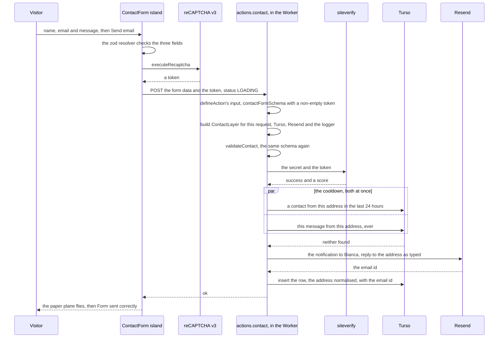
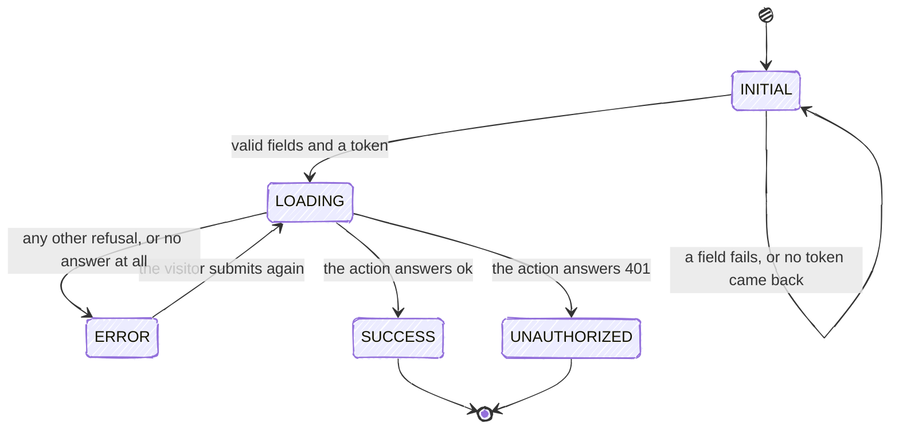

# Contact Form

The one thing a visitor can write to the site. The form on `/contact` is a React island in the browser, and a submission is an Astro server action in the Worker that checks the visitor is human, refuses an address it has already heard from, mails the message to Bianca through Resend, and keeps a row in Turso. The step order is load-bearing, and each failure has an answer of its own.

On a preview the form is not there at all: `HIDE_CHROME` replaces `/contact` with the under-construction placeholder, and the end-to-end specs for it skip themselves ([Rendering and Routing](Rendering-and-Routing#hide_chrome)).

---

## A submission

1. **The browser checks the fields first.** The island validates with `contactFormSchema`, the same schema the server holds, minus the token, so an empty name, an invalid address or an empty message is answered under its field without a request.
2. **reCAPTCHA scores the visitor invisibly.** The provider around the form loads Google's v3 script, and the submit asks it for a token. There is no checkbox to tick: a score comes back with the token, and the server reads it.
3. **The server checks everything again.** `defineAction` validates the payload at the edge, which is the only place an empty token is refused, and `validateContact` re-runs the schema inside the Effect program, so the program stays testable on its own. reCAPTCHA is verified after validation, so a malformed payload never costs a verification call.
4. **The cooldown is read before anything is sent**, so a refused visitor costs one Turso read and no email. Both queries run at once, and either one refuses.
5. **The email goes out before the row is written**, because the row stores Resend's email id. Once the email has gone the message has reached Bianca, so a row that fails to insert is logged and the visitor is still told it worked.

The code is [`src/actions`](https://github.com/fbuireu/biancafiore/tree/main/src/actions) for the program and the mapping of its errors, and `@infrastructure/utils` for each step; [`src/actions/AGENTS.md`](https://github.com/fbuireu/biancafiore/blob/main/src/actions/AGENTS.md) holds the invariants an implementer must keep.

---

## The cooldown

One message per person per day, and never the same message twice:

- **A 24-hour window.** A submission from an address that has a row newer than 24 hours is refused. The window is `CONTACT_COOLDOWN_HOURS` in `@domain/contact/rules`, counted back from the moment of the request.
- **The same message from the same address, at any time.** A submission whose message matches, word for word, one that address sent before is refused however long ago it was, so a resubmitted form a week later does not reach Bianca twice.
- **One person, one address.** Both rules compare the address normalised by `normalizeEmail`: trimmed, lower-cased and stripped of a `+alias`, so `Ana+site@example.com` and `ana@example.com` are the same person. The reply still goes to the address as the visitor typed it, alias included.
- **One answer, whichever rule fired.** The visitor reads *I've already received a message from you, and I'll reply as soon as I can.*, and the Worker log says which rule refused them, *inside the cooldown window* or *the same message as a previous submission*. Two different sentences would let anyone probe the contacts table for who has written.
- **The rows are the memory.** The cooldown counts rows, and a row is written only after the email has gone, so a submission whose row failed to insert leaves that address free to write again; two submissions that race past the check both go out, and the next one is refused normally.

---

## What the form shows

`FormStatus` is the island's state, and the only thing that decides what the visitor sees:

- **`LOADING`** shows the spinner on the button while the request is in flight; on success it lasts as long as the paper-plane animation, and not at all for a visitor who prefers reduced motion.
- **`SUCCESS`** replaces the form with *Form sent correctly! Will be in touch soon* and moves focus to it. The form does not come back until the page reloads.
- **`ERROR`** keeps the form live with the server's message above the button, so the visitor can fix what it names and submit again.
- **`UNAUTHORIZED`** is the cooldown. The action answers `401`, and the island locks every field and the button, because a retry would be refused the same way.

---

## When a step fails

| What failed | Where | Status | What the visitor sees | What was sent or saved |
|---|---|---|---|---|
| A field is empty, or the address is not one | the island | none, nothing is sent | the field's own message under it | nothing |
| reCAPTCHA has not loaded yet | the island | none | the button does nothing until it has | nothing |
| reCAPTCHA gives no token | the island | none | *Mr. Robot, is that you?* | nothing |
| The request never reaches the Worker | the browser | none | *Whoopsie! Your message didn't make it.*, the form stays live | nothing |
| A field or the token fails on the server | `defineAction`, `validateContact` | `400` | the validation message, the form stays live | nothing |
| The score is under 0.5, or the token expired or was replayed | `verifyRecaptcha` | `400` | *Mr. Robot, is that you? Please refresh the page and try again.* | nothing |
| siteverify is unreachable, answers no verdict, or refuses the secret | `verifyRecaptcha` | `500` | the generic *Whoopsie! Something went wrong.* message | nothing |
| The cooldown refuses the address | `checkDuplicateContact` | `401` | *I've already received a message from you…*, and the form locks | nothing |
| Turso fails during the cooldown check | `checkDuplicateContact` | `500` | the generic message | nothing: no email goes out without the check |
| Resend refuses or fails | `sendEmail` | `500` | the generic message, and a retry is allowed | nothing, so a retry is not a duplicate |
| The email template fails to render | `createEmail` | `500` | the generic message | nothing |
| Turso fails at the insert | `saveContact` | `200` | success | the email was delivered, the row was not written, and the Worker logs *Contact was delivered but not persisted* with the email id |
| `RESEND_API_KEY`, `ASTRO_DB_REMOTE_URL` or `ASTRO_DB_APP_TOKEN` is missing on the Worker | building `ContactLayer` | `500` | the layer's own message, which names the missing secret | nothing, before any step runs |

Only two refusals carry copy written for the visitor: a validation failure, and the cooldown. `contactErrorResponse` forwards those two verbatim and turns every other failure of the program, our configuration or a service being down, into the one generic message, after logging the whole cause for the Worker's log. That is deliberate: the other messages name our infrastructure, and none of them is the visitor's to act on beyond trying again later. The last row is the exception: `ContactLayer` is built before the program runs, so a layer that cannot be built fails outside that mapping, and Astro hands its message to the form as it is. A deploy cannot produce it, since `_deploy.yml` refuses to ship without those secrets, but a secret deleted from the Worker by hand, or a local run without `.dev.vars`, can.
