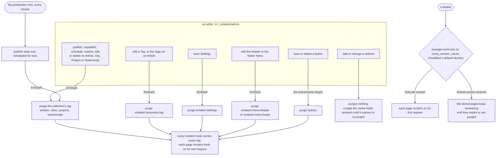

# Publishing

What an editor's save in the CMS does to the site. Content is written in EmDash's admin at `/_emdash/admin`, never from the repository, and nothing rebuilds: the pages render on request behind the Workers cache ([Request Lifecycle](Request-Lifecycle)), so publishing is a matter of telling that cache which pages are stale. It does that by purging cache tags.

---

## From a draft to the live page

1. **The editor writes a draft.** A draft is invisible to every request outside a preview, signed in or not, so nothing the site serves changes while it is being written.
2. **The editor previews it.** The preview link EmDash issues for an Article opens the Article's own page with a signed token, renders the draft under a banner and is never cached; [Request Lifecycle](Request-Lifecycle#a-draft-preview) draws that request.
3. **The editor publishes, schedules or saves.** EmDash writes the change to D1 and purges the cache tags of what it wrote, in the same request, before the admin answers.
4. **The next visitor renders the page fresh.** Every content route carries every content tag, so one purge empties the cache for the whole site; each page renders on its next request, reads the new content, and is cached again for a day.

---

## What purges what

- **An entry write purges its collection's tag.** Publishing, unpublishing, scheduling, restoring, editing and deleting an Article, a City, a Project or a Testimonial purge that collection's tag, which every content route carries, so the Blog, the Article, the tag pages, the feed and the sitemap all render fresh on their next request.
- **A scheduled publish purges when it happens.** EmDash promotes a scheduled entry from the Worker's `scheduled` handler, which the production cron calls every minute, and purges as it publishes, so a scheduled Article goes live within the minute after its time. Development declares no cron, so the previews, which share one database, never publish a scheduled entry by themselves.
- **A Tag purges the taxonomy's tag**, `emdash:taxonomy:tag`, whether the Tag itself changed or the Tags on an Article did. One save that adds more than 33 new Tags to an Article fails instead, because EmDash writes the new assignments in one D1 statement and D1 caps the variables a statement binds; the editor saves them in two goes, and nothing is purged until a save succeeds.
- **Settings and menus purge their own tags.** Saving *Settings* purges `emdash:settings`, and editing the `header` or the `footer` menu purges `emdash:menu:header` or `emdash:menu:footer`. Every page reads both in its chrome, so a new social link or menu label reaches every cached page at once. The two legal pages are the exception: they are prerendered, take today's defaults at build time and read nothing from EmDash, so a setting or a menu changed in the admin reaches them on the next deploy.
- **A byline purges through a plugin.** EmDash's own byline routes purge nothing, so a changed bio, job title or avatar would wait out the day's `max-age`. The `bylineCache` plugin, in [`src/infrastructure/cms/plugins/bylineCache`](https://github.com/fbuireu/biancafiore/tree/main/src/infrastructure/cms/plugins/bylineCache), listens for `byline:afterSave` and `byline:afterDelete` and purges the `bylines` tag every content route carries, through the same `cache.purge` from `cloudflare:workers` that Astro's cache provider calls. Crediting a different byline on an Article is an edit of the Article, and purges like one.

The tag list is `CONTENT_CACHE` in [`src/const/contentCache.ts`](https://github.com/fbuireu/biancafiore/blob/main/src/const/contentCache.ts), and [ADR 0022](https://github.com/fbuireu/biancafiore/blob/main/docs/adr/0022-content-renders-per-request-behind-the-workers-cache.md) records why every route carries all of it: a page reads more than it looks like it does, and a missing tag is a page a day stale, against a few cold renders on a site this size.

---

## What purges nothing

- **A redirect.** EmDash's *Redirects* run in its middleware, in this Worker, ahead of every page, and a redirect is not a content write, so adding one purges nothing: when its source is a page the cache still holds, the cache keeps answering that page until its entry expires or another write purges it, and only then does the request reach the Worker and the redirect. A redirect whose source answered 404 works at once, because no 404 is ever stored. The common case needs nothing, because changing an Article's slug saves the Article and purges every content route.
- **A media upload on its own.** An image reaches a page only through an entry, a byline or the settings that reference it, and saving that reference purges. A new upload has a key of its own, so the page that now names it shows it on its next request.
- **Replacing a file in the media library.** The replacement keeps the file's storage key, and the Workers cache stores each resized rendition for a day under a rule that carries no tag, since no tag EmDash purges names a media file. A page that shows the image keeps its old rendition until that day, and the hour of `stale-while-revalidate` after it, run out; uploading the new file instead and picking it in the entry shows it at once ([Request Lifecycle](Request-Lifecycle#an-image)).

---

## A deploy and the stored pages

Whether a new Worker version reads the pages the previous one stored is `cross_version_cache`, under `[cache]`, and `wrangler.toml` does not set it, so Cloudflare's default for it decides and nothing in this repository pins which way that goes. If the cache is kept per version, each page renders on its first request after a deploy, from D1, and each image is resized again on its first. If it is shared, the pages the previous version stored keep answering, with that version's markup, until they expire or a publish purges them, and the resized images until they expire. Either way the first request that reaches the new version is the moment EmDash applies any migration it brought, and a rollback returns the previous Worker version without undoing them ([CI/CD](CI-CD#limits)).

---

## The email the CMS sends

EmDash sends an invitation, a sign-in link or an account recovery by email, and the site is its email provider: the `emailDelivery` plugin holds the exclusive `email:deliver` hook and hands every message to the same Resend client and sender the contact form uses, tagged `cms`. Without the plugin EmDash would send nothing, and an invitation link would have to be passed on by hand.

When Resend refuses a message, or `RESEND_API_KEY` is missing, the hook rejects and nothing is sent. The admin shows an invitation's failure as an error, while a sign-in link fails quietly: EmDash logs it and still tells the person that a link is on its way, so as not to reveal which addresses have an account. A sign-in link that never arrives is worth a look at the Worker's logs.
