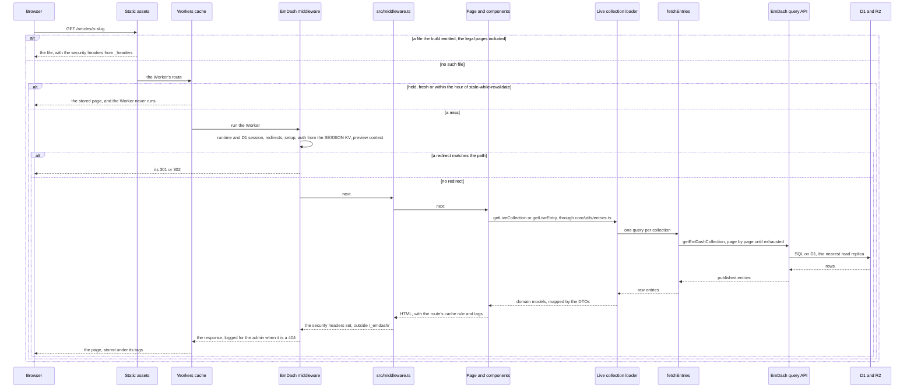
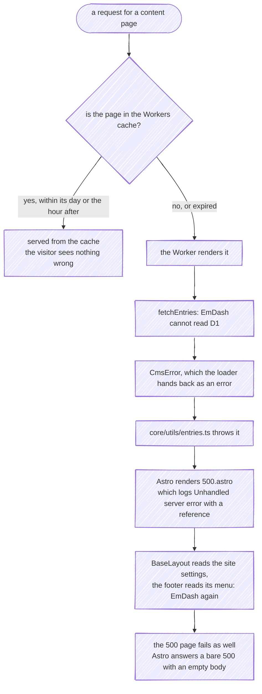
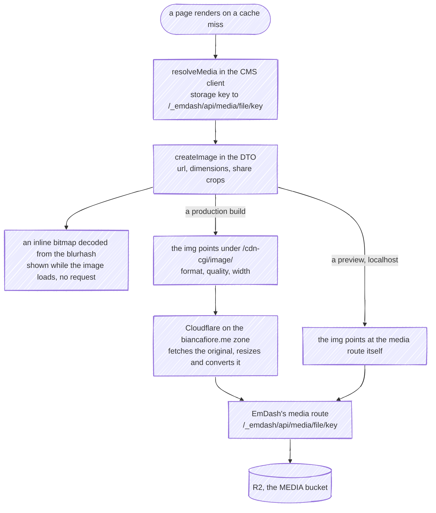
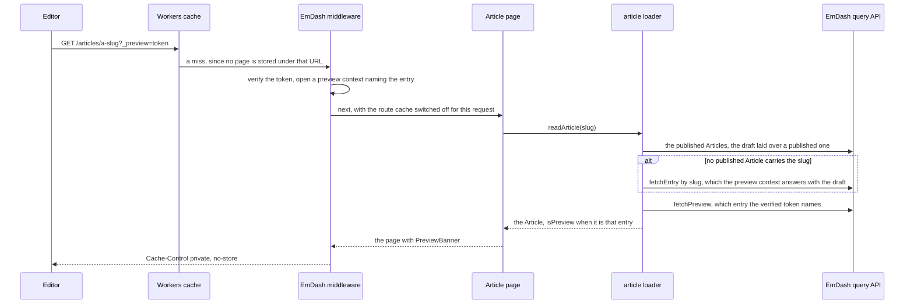

# Request Lifecycle

What happens between a visitor asking for a page and the page arriving: which layer answers, where the Workers cache sits, what a cache miss reads, and what the visitor gets when something on that path fails. The rendering decisions behind it are on [Rendering and Routing](Rendering-and-Routing); what clears the cache is on [Publishing](Publishing).

---

## A page request

Everything runs in one Cloudflare Worker, [`src/worker.ts`](https://github.com/fbuireu/biancafiore/blob/main/src/worker.ts), which is EmDash's handler wrapped around Astro's. Three things stand in front of the code this repository writes, and most requests never get past the second:

1. **Static assets answer first.** Whatever the build put in `dist/client`, the scripts, the stylesheets, the fonts, `robots.txt`, `/.well-known/security.txt` and the two prerendered legal pages, is served by Cloudflare before the Worker runs, with the security headers the build wrote into `_headers`.
2. **The Workers cache answers next.** A content page is stored with a day's `max-age`, an hour of `stale-while-revalidate` and the nine content tags, so most visits end here, at the edge, without a line of the Worker running. Because the cache answers before the Worker, a signed-in editor gets the same cached page as everyone else, without EmDash's toolbar.
3. **On a miss, EmDash's middleware runs before the site's.** The integration registers it ahead of [`src/middleware.ts`](https://github.com/fbuireu/biancafiore/blob/main/src/middleware.ts): it opens the D1 session (an anonymous read goes to the nearest replica), answers a path an editor redirected with its 301 or 302, reads the admin session from the `SESSION` KV, and opens the preview context a [draft preview](#a-draft-preview) needs. After the page has rendered, it records the path of any 404 for the admin's *Redirects* screen, so an editor can see which old links still arrive.
4. **The site's middleware sets the security headers** on every response the Worker renders, and leaves anything under `/_emdash/` alone, because EmDash sets its own, stricter policy there.
5. **The page reads content through a live collection**, never through the CMS. `core/utils/entries.ts` is the one module that calls `getLiveCollection` and `getLiveEntry`; the collection's loader, in `src/application/entities`, calls `fetchEntries`, which walks every page of the query and hands the entries to the DTOs that map them into the domain. [Content Model](Content-Model) follows one entry along that path.
6. **The response leaves with its cache rule.** Astro's Cloudflare cache provider writes the route's rule into `Cloudflare-CDN-Cache-Control` and the tags into `Cache-Tag`, and the cache stores the page under them until it expires or a [publish](Publishing) purges a tag it carries.

**There is no locale anywhere on this path.** The site has no i18n: one language, `en-GB`, which every date and every sort uses, no locale in a URL, no page that reads the visitor's `Accept-Language`, and an admin EmDash offers in English alone.

---

## The routes

| Route | Renders | Cache | Reads from EmDash |
|---|---|---|---|
| `/` | on request | content rule | the site's Author, the site settings, the Projects, the Testimonials, the head of the Blog |
| `/about` | on request | content rule | the Cities, the site's Author, the Blog |
| `/contact` | on request | none | the head of the Blog; the form posts to a server action, which writes to Turso ([Contact Form](Contact-Form)) |
| `/projects` | on request | content rule | the Projects |
| `/articles` | on request | content rule | every Article |
| `/articles/[...slug]` | on request | content rule; a preview answers `private, no-store` and is never stored | the Article whole, its hand-picked Related Articles, every Article for the inferred ones, and the preview the link names |
| `/tags` | on request | content rule | the Tag Index |
| `/tags/[slug]` | on request | content rule | the Tag or Author Tag, every Article |
| `/privacy-policy`, `/terms-and-conditions` | at build, served as assets | the assets' own | nothing: the chrome takes the settings' and the menus' defaults |
| `/rss.xml` | on request | content rule | every Article, the site settings |
| `/sitemap.xml` | on request | content rule | every Article, the Tag Index |
| `/sitemap-index.xml` | a redirect to `/sitemap.xml` | none | nothing |
| `/404` | on request, for every unknown path | content rule | the head of the Blog |
| `/500` | on request, after an unhandled error | none | nothing of its own |
| `/_emdash/admin`, `/_emdash/api/…` | by EmDash | `private, no-store` | what the admin edits |
| `/_emdash/api/media/file/…` | by EmDash | `public, max-age=0, must-revalidate` for an image | the file, from R2 |

The **content rule** is the one `CONTENT_CACHE` in [`src/const/contentCache.ts`](https://github.com/fbuireu/biancafiore/blob/main/src/const/contentCache.ts) holds for every route in `CONTENT_ROUTES`: a day's `max-age`, an hour of `stale-while-revalidate`, and the tags of every content collection, of the `tag` taxonomy, of the bylines, of the site settings and of the two menus. Every content route carries every tag, because a page reads more than it looks like it does (the Article page reads every Article to infer its Related Articles) and a missing tag is a page a day stale.

Every page the Worker renders also reads its **chrome**: the site settings, the `footer` menu and, unless `HIDE_CHROME` hides the header, the `header` menu. That is why `/500` reads EmDash although it shows no content, and why a route with no rule still needs the settings and menus to answer. A response with no rule can still be cached heuristically for up to two hours, so a changed menu or setting reaches `/contact` that much later.

An unknown Article or Tag slug renders the 404 page in place (`Astro.rewrite("/404")`), so the visitor stays on the URL they asked for and gets the 404 status. An unknown path first passes EmDash's redirects, and when none matches it gets the same 404 page, which the cache stores under the content rule like any other.

---

## When the database is down

D1 unreachable, or EmDash unable to answer, is felt only on a cache miss:

- **A page the cache holds keeps being served** for as long as its entry lives: a day from when it was rendered, plus the hour of `stale-while-revalidate` after that, during which the background refresh fails without the visitor seeing it. The legal pages and every static file are assets, and keep answering whatever happens to the database.
- **A miss answers 500.** The loader's query fails with a `CmsError`, `contentLoader` hands it back as the collection's error rather than a short list, and the reader in `core/utils/entries.ts` throws it, because a page that lost the CMS should fail rather than render a partial listing.
- **The 500 page itself depends on the CMS.** It renders inside `BaseLayout`, which reads the site settings, and the footer reads its menu, so with D1 down it fails the same way. Astro then retries it without the middleware, and when that fails too it answers a bare `500` with an empty body: the visitor gets the browser's own error screen, without the site's copy and without a reference. The log still carries the failure, because `500.astro` writes its line before the layout renders.
- **The admin is down with it**, since EmDash keeps its users, sessions and content in the same database.

The same 500 answers a request whose content is broken rather than unreachable: the DTOs refuse an Article whose publish date cannot be read, one no byline credits, or an image without a resolved file, and that refusal fails every page that reads the entry, the listings and `/404` included, until an editor fixes it in the admin. A database with no published Article credited to the site's own byline fails `/` and `/about` the same way, which is where a freshly created stage starts.

---

## The 500 page and its reference

When a request throws and the 500 page can render, the visitor reads *Reference: 500 · 1a2b3c4d*: eight hexadecimal characters `createErrorReference` draws for that request. `500.astro` logs the error in the same breath, as one line through `@infrastructure/logging/logger.ts`:

- `message` is *Unhandled server error*, at `level` `error`;
- `path` is the path the visitor asked for, without its query string;
- `reference` is the eight characters on the visitor's screen;
- `error` holds the error's message, name and stack.

Logs and traces leave the Worker through Cloudflare's export to Better Stack ([CI/CD](CI-CD) says how), so a visitor who quotes the reference is one query away from their line: filter on `reference`. The page prints the reference and never the error, because what failed is for the log and not for the visitor. A 500 page reached directly, with no error behind it, prints *Reference: 500* alone and logs nothing.

---

## An image

Every image an editor uploads lives in R2, in the stage's `MEDIA` bucket, and EmDash records its dimensions and a blurhash in D1. A page never links the bucket: it links EmDash's media route, on the site's own origin, and in production it asks Cloudflare to resize and convert on the way.

- **The URL is a path, made once.** `resolveMedia` in [`src/infrastructure/cms/media.ts`](https://github.com/fbuireu/biancafiore/blob/main/src/infrastructure/cms/media.ts) turns EmDash's storage key into a path on the media route before any mapper sees it, and nothing but `absoluteUrl` turns that path into a full URL, where an Open Graph tag or a JSON-LD document needs one.
- **Production transforms; nothing else can.** In a production build, Astro's image service is Cloudflare's, so an `<Image>` component points at `/cdn-cgi/image/…`, and `getOptimizedImageUrl` does the same for an Article's body images and the share crops. A preview on `workers.dev` and the dev server sit on no zone that could transform, so both serve the original from the media route.
- **The media route serves R2 under EmDash's own headers.** An image answers `public, max-age=0, must-revalidate` with validators, so a browser revalidates instead of downloading again, and a sandboxing content security policy; a type that is not a plain image is served as a download. The site's middleware leaves the route alone, as it does everything under `/_emdash/`.
- **The blur costs nothing.** EmDash computes a blurhash on upload, and `createImage` decodes it into a small inline bitmap the `BlurImage` component shows behind the image until it arrives. A format EmDash computes no blurhash for, AVIF among them, renders unblurred.

---

## A draft preview

An editor checks a draft before publishing it from a preview link EmDash issues in the admin: the Article's own URL with a signed `_preview` token. Only Articles have one.

- **A preview is never stored.** EmDash's middleware switches the route cache off for any request carrying a `_preview` token, valid or not, and answers a valid one `private, no-store`, so a draft cannot leak to a visitor through the cache or outlive its token there.
- **Drafts are for the preview context alone.** Every other query asks for published entries, whoever is signed in; inside a preview, a collection query lays a draft over an Article already published, and the page asks for the single entry by its slug when no published Article carries it, which is how a never-published Article previews at all.
- **The banner cannot be raised by hand.** The page shows `PreviewBanner` only when the entry the verified token names is the Article on the page; a forged or foreign token names nothing, so the visitor gets the published Article, or the 404 page, with no banner.

Publishing the draft is the next step, and it is on [Publishing](Publishing).
